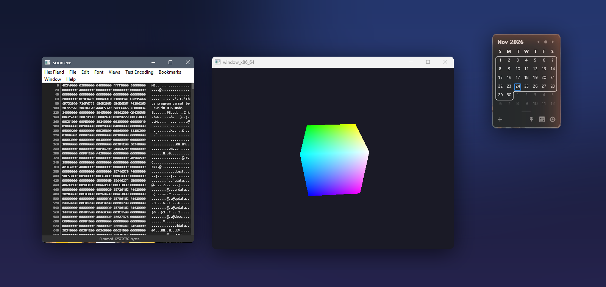

# Scion

[](https://github.com/inigo99/scion/actions/workflows/ci.yml)
[](https://github.com/inigo99/scion/releases/latest)
[](LICENSE)


**Ejecuta apps de macOS en Windows.** Scion carga programas de macOS (Mach-O, de Intel y de Apple Silicon) directamente
en un proceso de Windows: sin Mac, sin máquina virtual y sin instalar macOS. Hoy funcionan herramientas de línea de
comandos, apps de AppKit y SwiftUI y gráficos Metal, para un conjunto de programas que no deja de crecer.

[Read in English](README.md)

<p align="center"><br><sub>Hex Fiend (AppKit), una ventana Metal (<code>CAMetalLayer</code>) y el calendario de la barra de menús de Itsycal: binarios de macOS sin modificar, ejecutándose en Windows 11.</sub></p>

> **Estado: experimental.** Scion ejecuta apps reales de terceros (Hex Fiend, Itsycal, Reminders MenuBar, SwiftFormat,
> esbuild, Biome) y pasa su propia batería de pruebas, pero a la mayoría de las apps de macOS todavía les falta algo. Crece
> app a app, como hizo Wine. Las contribuciones son muy bienvenidas: mira [CONTRIBUTING.md](CONTRIBUTING.md).

## Qué hace

| | |
|---|---|
| **Las dos arquitecturas de Mac** | Los programas x86_64 se ejecutan de forma nativa. Los arm64 (Apple Silicon), junto con las versiones arm64 de las bibliotecas de Scion, se traducen a x86_64 mientras se ejecutan con [dynarmic](https://github.com/azahar-emu/dynarmic); todo lo que está detrás de la tabla de llamadas al anfitrión (ventanas, GPU, ficheros, audio) sigue siendo nativo. Los binarios universales usan x86_64 salvo que pidas arm64. |
| **Su propio runtime de macOS** | dyld, libSystem (POSIX, Mach, GCD, señales), el runtime de Objective-C, Foundation, CoreFoundation, libc++, AppKit, CoreGraphics, GameController, AudioToolbox y más, escritos desde cero para Windows. |
| **Metal sobre Vulkan** | Los shaders compilados por Apple (`.metallib`, bitcode AIR) se traducen a SPIR-V; el código Metal Shading Language se compila en tiempo de ejecución con Clang. Cómputo, render, ventanas (`CAMetalLayer`, `MTKView`), parte de Metal 4 y MetalFX. |
| **Swift** | El runtime y la biblioteca estándar de Swift, los overlays de Darwin, Dispatch y Foundation, Swift Concurrency, y Combine y SwiftUI propios de Scion. |
| **Se siente como Windows** | Ventanas Win32 reales, menús, diálogos de archivo, iconos en el área de notificación, teclado, ratón, mandos XInput con vibración y audio WASAPI. `scion install` añade una app al menú Inicio con su icono y sus tipos de archivo. |

En Linux funciona de forma nativa (una vista previa, compilando desde el código fuente) o con
[Wine](https://www.winehq.org/): mira [En Linux](#en-linux).

## Empezar

1. Descarga la última versión desde la página de [Releases](../../releases) y descomprímela donde quieras.
2. Comprueba que el driver de tu GPU admite Vulkan 1.3 (los actuales de NVIDIA, AMD e Intel lo hacen). Solo lo necesitan
   las apps que usan Metal.
3. Ejecuta un programa o una app de macOS:

```powershell
scion.exe ruta\a\herramienta --help          # un programa de línea de comandos
scion.exe "ruta\a\Una App.app"               # una app
scion.exe install "ruta\a\Una App.app"       # acceso en el menú Inicio, icono, "Abrir con" y entrada para desinstalar
scion.exe uninstall "ruta\a\Una App.app"
```

`scionw.exe` hace lo mismo sin ventana de consola (lo usan los accesos del menú Inicio; la salida va a
`%LOCALAPPDATA%\scion\logs`). Con `SCION_ARCH=arm64` se ejecuta la parte Apple Silicon de un binario universal. El resto
de opciones están en [docs/environment.md](docs/environment.md).

Scion ejecuta programas que ya tienes. No contiene nada de macOS (solo código que Apple publica como software libre, con
sus licencias abiertas), y no necesitas un Mac ni el SDK de Apple.

## En Linux

Scion funciona en Linux a través de Wine, igual que las pruebas en la integración continua. Necesitas Wine 9 o más
reciente y, para las apps que usan Metal, un driver de Vulkan (los de Mesa valen):

```sh
sudo apt install wine64 mesa-vulkan-drivers    # Debian/Ubuntu; en otras distribuciones, sus paquetes
wine scion.exe ruta/a/herramienta --help
wine scion.exe "ruta/a/Una App.app"
wine scion.exe install "ruta/a/Una App.app"    # Wine lo convierte en una entrada .desktop y asociaciones de archivo
```

Las rutas de Linux funcionan tal cual: Scion las convierte en rutas de la unidad `Z:` de Wine.

**Anfitrión nativo (vista previa).** Al compilar desde el código fuente también se genera `bin/scion`, un programa de
Linux que ejecuta programas de macOS sin Wine: `bin/scion ruta/a/herramienta` o `bin/scion "ruta/a/Una App.app"`.
Funcionan programas de línea de comandos, apps de AppKit y SwiftUI y Metal, de Intel y de Apple Silicon, con ventanas,
entrada, mandos y audio a través de SDL2 y Metal sobre Vulkan (`scion-metal.so`, `scion-msl.so`); pasa toda la batería
de pruebas salvo `scion install`. Falta todavía: la barra de menús, los iconos en la bandeja y `scion install`. Se agradece ayuda ([issue](../../issues/10)).

## Cómo funciona

```
   programa de macOS (Mach-O, x86_64 o arm64)
          │  lo carga y lo enlaza el dyld de Scion
          ▼
 ┌─────────────── lado invitado: bibliotecas Mach-O compiladas desde este repo ───────────────┐
 │  libSystem · libobjc · Foundation · AppKit · Metal · GameController · AudioToolbox         │
 │  libc++ · runtime de Swift · Combine · SwiftUI                                             │
 └─────────────────────────────────────────────┬──────────────────────────────────────────────┘
                                               │  llamadas al anfitrión: hilos, memoria, ficheros, ventanas, GPU…
 ┌─────────────────────────────────────────────┴──────────────────────────────────────────────┐
 │  scion.exe: cargador, JIT arm64 → x86_64, ventanas Win32, entrada, audio                   │
 │  scion-metal.dll: Metal sobre Vulkan, AIR → SPIR-V · scion-msl.dll: compilador de MSL      │
 └────────────────────────────────────────────────────────────────────────────────────────────┘
```

Las bibliotecas del lado invitado son dylibs Mach-O de verdad que implementan las API y el ABI de Apple, así que el
binario de una app se enlaza con ellas igual que en macOS. Todo lo que necesita al sistema pasa por una única tabla
estrecha de llamadas a `scion.exe`. [docs/architecture.md](docs/architecture.md) explica las piezas.

## Documentación

La documentación técnica está en inglés:

- [Arquitectura](docs/architecture.md): cómo un programa de macOS acaba ejecutándose en Windows
- [Compilación](docs/building.md): compilar todo desde el código fuente en Linux
- [Pruebas](docs/testing.md): la batería de pruebas, en Linux con Wine y en Windows
- [Compatibilidad](docs/compatibility.md): qué funciona, qué no y cómo averiguar por qué falla una app
- [Variables de entorno](docs/environment.md): opciones para ejecutar, trazar y perfilar
- [Hoja de ruta](docs/roadmap.md): hacia dónde va el proyecto

## Contribuir

Son bienvenidos los informes de errores con un caso reproducible, las correcciones y las API nuevas. La forma más fácil
de empezar es una app que casi funciona: ejecútala con `SCION_TRACE=1`, mira qué falta, impleméntalo y añade una prueba.
Antes, lee [CONTRIBUTING.md](CONTRIBUTING.md): explica la regla de "sala limpia" que mantiene el proyecto seguro desde el
punto de vista legal.

## Licencia

Scion se publica con la [licencia MIT](LICENSE). Se apoya en otros proyectos de código abierto con sus propias licencias
(dynarmic, Indium, LLVM, Swift, las cabeceras de código abierto de Apple y otros); consulta
[THIRD_PARTY_NOTICES.md](THIRD_PARTY_NOTICES.md).

## Aviso legal

Scion es un proyecto independiente. No está afiliado a Apple Inc., ni cuenta con su respaldo o patrocinio. Apple, macOS,
Metal, Swift, SwiftUI, AppKit, Xcode y Apple Silicon son marcas de Apple Inc., que aquí solo se usan para describir la
compatibilidad. Scion no contiene código ni binarios del software propietario de Apple. Eres responsable de respetar las
licencias de los programas que ejecutes con él.

## Agradecimientos

Scion no existiría sin [dynarmic](https://github.com/azahar-emu/dynarmic), [Indium](https://github.com/darlinghq/indium)
y darling-metal del proyecto [Darling](https://www.darlinghq.org/), [LLVM](https://llvm.org/),
[Swift](https://www.swift.org/), las cabeceras SPIR-V de [Khronos](https://www.khronos.org/),
[MinGW-w64](https://www.mingw-w64.org/) y [Wine](https://www.winehq.org/), y sin todas las personas que han documentado
cómo funciona macOS.
