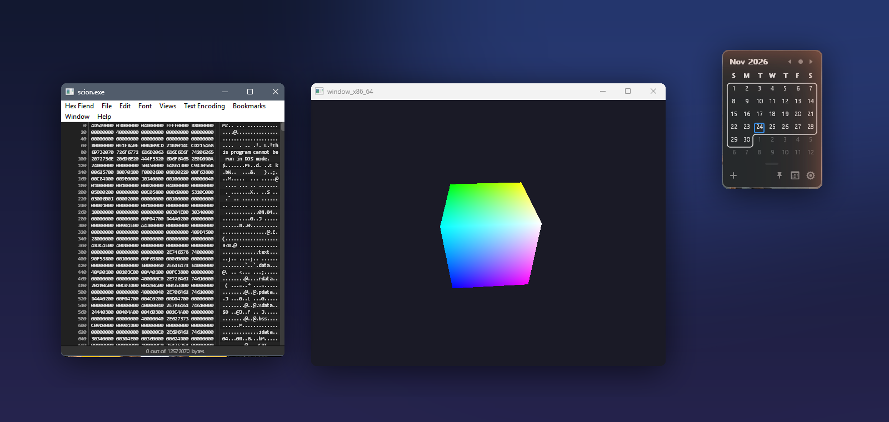

# Scion

[](https://github.com/inigo99/scion/actions/workflows/ci.yml)
[](https://github.com/inigo99/scion/releases/latest)
[](LICENSE)


**Run macOS apps on Windows.** Scion loads macOS programs (Mach-O, Intel and Apple Silicon) straight into a Windows
process: no Mac, no virtual machine, no macOS install. Command-line tools, AppKit and SwiftUI apps, and Metal graphics
work today, for a growing set of programs.

[Leer en español](README.es.md)

<p align="center"><br><sub>Hex Fiend (AppKit), a Metal window (<code>CAMetalLayer</code>) and Itsycal's menu bar calendar, unmodified macOS binaries, running on Windows 11.</sub></p>

> **Status: experimental.** Scion runs real third-party apps (Hex Fiend, Itsycal, Reminders MenuBar, SwiftFormat,
> esbuild, Biome) and passes its own test suite, but most macOS apps still need something it does not have yet. It grows
> app by app, the way Wine did. Contributions are very welcome; see [CONTRIBUTING.md](CONTRIBUTING.md).

## What it does

| | |
|---|---|
| **Both Mac architectures** | x86_64 programs run natively. arm64 (Apple Silicon) programs, with the arm64 builds of Scion's libraries, are translated to x86_64 at run time by [dynarmic](https://github.com/azahar-emu/dynarmic); everything behind the host-call table (windows, GPU, files, audio) stays native. Universal binaries use x86_64 unless you ask for arm64. |
| **Its own macOS runtime** | dyld, libSystem (POSIX, Mach, GCD, signals), the Objective-C runtime, Foundation, CoreFoundation, libc++, AppKit, CoreGraphics, GameController, AudioToolbox and more, written from scratch for Windows. |
| **Metal on Vulkan** | Apple-compiled shaders (`.metallib`, AIR bitcode) are translated to SPIR-V; Metal Shading Language source is compiled at run time with Clang. Compute, render, windows (`CAMetalLayer`, `MTKView`), parts of Metal 4 and MetalFX. |
| **Swift** | Swift's runtime and standard library, the Darwin/Dispatch/Foundation overlays, Swift Concurrency, and Scion's own Combine and SwiftUI. |
| **Feels like Windows** | Real Win32 windows, menus, file dialogs, notification-area icons, keyboard, mouse, XInput gamepads with rumble, WASAPI audio. `scion install` adds an app to the Start menu with its icon and file types. |

On Linux it runs natively (a preview) or under [Wine](https://www.winehq.org/): see [On Linux](#on-linux).

## Quick start

1. Download the latest release from the [Releases](../../releases) page and unzip it anywhere.
2. Make sure your GPU driver supports Vulkan 1.3 (current NVIDIA, AMD and Intel drivers do). Only Metal apps need it.
3. Run a macOS program or app bundle:

```powershell
scion.exe path\to\tool --help             # a command-line program
scion.exe "path\to\Some App.app"          # an app bundle
scion.exe install "path\to\Some App.app"  # Start menu shortcut, icon, "Open with" and an uninstall entry
scion.exe uninstall "path\to\Some App.app"
```

`scionw.exe` does the same without a console window (the Start menu shortcuts use it; output goes to
`%LOCALAPPDATA%\scion\logs`). Set `SCION_ARCH=arm64` to run the Apple Silicon half of a universal binary. More switches
are in [docs/environment.md](docs/environment.md).

Scion runs programs you already have. It contains nothing from macOS itself (only code Apple publishes as open source,
under its open licenses), and you do not need a Mac or an Apple SDK.

## On Linux

**Natively (preview).** Download `scion-<version>-linux-x86_64.tar.xz` (`.tar.gz` up to 0.2.0) from
[Releases](../../releases), unpack it and run `scion` from it. It needs a recent distribution (built on Ubuntu 24.04)
with SDL2, FreeType, fontconfig, libpng, libjpeg, Vulkan and LLVM 20, plus a Vulkan driver for Metal apps:

```sh
sudo apt install libsdl2-2.0-0 libfreetype6 libfontconfig1 libpng16-16 libjpeg-turbo8 libvulkan1 libllvm20 \
                 mesa-vulkan-drivers zenity          # Debian/Ubuntu; zenity gives the file dialogs
./scion path/to/tool --help
./scion "path/to/Some App.app"
./scion install "path/to/Some App.app"   # application menu entry, icon and file types (freedesktop.org)
./scion uninstall "path/to/Some App.app"
```

Command-line programs, AppKit and SwiftUI apps and Metal run, Intel and Apple Silicon; the whole test suite passes
natively. Not there yet: the menu bar and status items in the tray ([issue](../../issues/10)).

**With Wine.** `scion.exe` from the Windows zip runs under Wine 9 or newer too, which is how the test suite first ran
in CI:

```sh
sudo apt install wine64 mesa-vulkan-drivers
wine scion.exe "path/to/Some App.app"           # Linux paths work as they are: Scion turns them into Z: paths
```

## How it works

```
   macOS program (Mach-O, x86_64 or arm64)
          │  loaded and linked by Scion's dyld
          ▼
 ┌──────────────────── guest side: Mach-O libraries built from this repo ─────────────────────┐
 │  libSystem · libobjc · Foundation · AppKit · Metal · GameController · AudioToolbox         │
 │  libc++ · Swift runtime · Combine · SwiftUI                                                │
 └─────────────────────────────────────────────┬──────────────────────────────────────────────┘
                                               │  host calls: threads, memory, files, windows, GPU…
 ┌─────────────────────────────────────────────┴──────────────────────────────────────────────┐
 │  scion.exe: loader, arm64 → x86_64 JIT, Win32 windows, input, audio                        │
 │  scion-metal.dll: Metal on Vulkan, AIR → SPIR-V · scion-msl.dll: MSL compiler              │
 └────────────────────────────────────────────────────────────────────────────────────────────┘
```

The guest libraries are real Mach-O dylibs that implement Apple's APIs and ABI, so an app's binary links against them
exactly as it would on macOS. Whatever needs the host goes through one narrow table of host calls into `scion.exe`.
[docs/architecture.md](docs/architecture.md) explains the pieces.

## Documentation

- [Architecture](docs/architecture.md): how a macOS program ends up running on Windows
- [Building](docs/building.md): building everything from source on Linux
- [Testing](docs/testing.md): the regression suite, on Linux with Wine and on Windows
- [Compatibility](docs/compatibility.md): what works, what does not, and how to find out why an app fails
- [Environment variables](docs/environment.md): switches for running, tracing and profiling
- [Roadmap](docs/roadmap.md): where the project is going

## Contributing

Bug reports with a reproducible case, fixes and new APIs are all welcome. The easiest way in is an app that almost
works: run it with `SCION_TRACE=1`, see what is missing, implement it and add a test. Please read
[CONTRIBUTING.md](CONTRIBUTING.md) first; it explains the clean-room rule that keeps the project legally safe.

## License

Scion is released under the [MIT License](LICENSE). It builds on other open-source projects under their own licenses
(dynarmic, Indium, LLVM, Swift, Apple's open-source headers, and others); see
[THIRD_PARTY_NOTICES.md](THIRD_PARTY_NOTICES.md).

## Disclaimer

Scion is an independent project. It is not affiliated with, endorsed by or sponsored by Apple Inc. Apple, macOS, Metal,
Swift, SwiftUI, AppKit, Xcode and Apple Silicon are trademarks of Apple Inc., used here only to describe compatibility.
Scion contains no code or binaries from Apple's closed-source software. You are responsible for respecting the licenses
of the programs you run with it.

## Acknowledgements

Scion would not exist without [dynarmic](https://github.com/azahar-emu/dynarmic),
[Indium](https://github.com/darlinghq/indium) and darling-metal from the [Darling](https://www.darlinghq.org/) project,
[LLVM](https://llvm.org/), [Swift](https://www.swift.org/), the [Khronos](https://www.khronos.org/) SPIR-V headers,
[MinGW-w64](https://www.mingw-w64.org/) and [Wine](https://www.winehq.org/), and the many people who documented how
macOS works.
